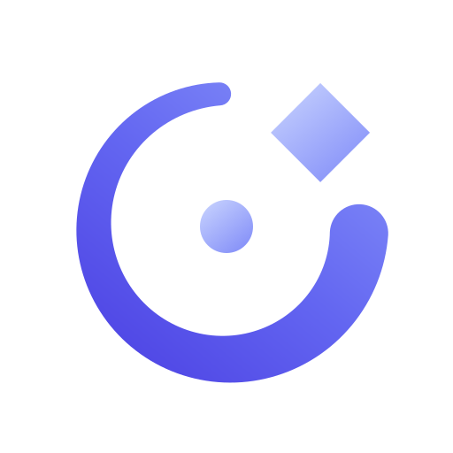

  

<h1 align="center">Parsec</h1>

<b>Self-hosted project & ticket management, running our own way.</b>

  
  
  
  

---

## What this is

Parsec is a fork of [It's a Plan](https://github.com/croffasia/itsaplan), an
open-source project management and issue tracker, licensed under
**AGPL-3.0**. It runs our internal work for NAFDO/PayGlue projects, not as a
public product. Details on what we changed and why: [FORK.md](./FORK.md).

The previous Parsec was a fork of Plane. It is archived as
[Nuenni/Parsec-Plane](https://github.com/Nuenni/Parsec-Plane).

## What's different from It's a Plan

- Parsec name and logo in the web app, the installable app icon and the
  outgoing emails
- Everything else follows upstream. Our own extensions are tracked in the
  Parsec project and listed in [FORK.md](./FORK.md) once they land.

## Setup

Installation and operation follow upstream's own documentation:
[self-hosting](docs/self-hosting.md) and [Coolify](docs/coolify.md). We run
it on Coolify.

## License and origin

AGPL-3.0. This project is not affiliated with, and is not endorsed by, the
authors of It's a Plan. Paid "Pro" features of It's a Plan are not part of
this repository and are not unlocked here.

## Forking Parsec

The code is AGPL-3.0, feel free to fork it. The name and logo "Parsec" are
not covered by that licence, so please replace the branding with your own,
the way we replaced upstream's. See [FORK.md](./FORK.md) for the rest.
